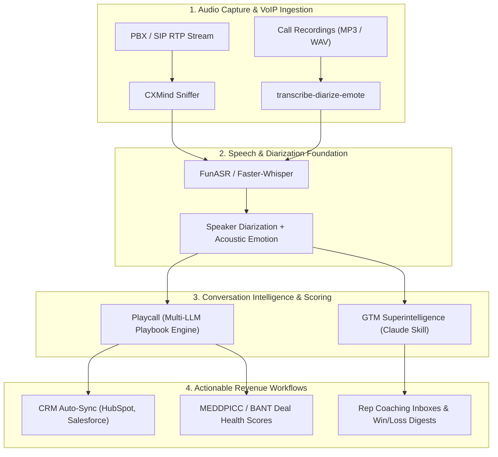

# 🎙️ Awesome Conversation Intelligence & Speech Analytics

**A curated index of top Conversation Intelligence (CI), Speech Analytics, ASR, Speaker Diarization, and Open-Source Gong Alternatives 🚀**

🌟 *Star this repository if you find it helpful!* 🌟

---

## 📌 Overview & SEO Summary

This repository is a definitive, search-optimized guide tracking notable **SaaS conversation intelligence platforms** and **open-source speech analytics frameworks**. 

Whether you are a sales leader searching for enterprise revenue intelligence solutions (like Gong, Chorus, and Salesloft) or an engineering team seeking self-hosted, privacy-first Gong alternatives (like Playcall, FunASR, and GTM Superintelligence), this curated list covers:

- 🎯 **Automated Call Scoring & Rubrics**: MEDDPICC, BANT, SPIN, and custom sales methodology evaluation.
- 🗣️ **Speech Recognition (STT / ASR)**: Production Whisper pipelines, FunASR, and streaming transcription engines.
- 👥 **Speaker Diarization & Audio Analytics**: Acoustic emotion detection, talk-to-listen ratios, and objection tracking.
- 🛡️ **Self-Hosted & Privacy-First Deployments**: Full control over customer audio recordings, local LLM integration (Ollama, vLLM, BYOK), and data sovereignty.

---

## 📑 Table of Contents

- [🏢 SaaS & Hosted Platforms](#-saashosted-platforms)
  - [📊 SaaS Quick Comparison & Pricing Matrix](#-saas-quick-comparison--pricing-matrix)
  - [🔍 Detailed SaaS Profiles](#-detailed-saas-profiles)
- [🔓 Open-Source GitHub Projects](#-open-source-github-projects)
  - [⭐ Featured Open-Source Projects](#-featured-open-source-projects)
  - [🛠️ Additional Strong Open-Source Options](#️-additional-strong-open-source-options)
  - [🧱 Composable Open-Source CI Stack Architecture](#-composable-open-source-ci-stack-architecture)
- [🤝 How to Contribute](#-how-to-contribute)
- [⚖️ Disclaimer & Compliance](#️-disclaimer--compliance)

---

## 🏢 SaaS/Hosted Platforms

### 📊 SaaS Quick Comparison & Pricing Matrix

| Platform | Category / Focus | Key Strengths | Pricing Model | Free Tier Limits |
|:---|:---|:---|:---|:---|
| **[Gong](https://www.gong.io/)** | Enterprise Revenue Intelligence | Market leader, deep CRM ecosystem, deal forecasting | Quote-only (custom enterprise contracts) | ❌ None |
| **[Chorus by ZoomInfo](https://www.zoominfo.com/)** | CI + B2B Prospect Data | Integrated with ZoomInfo data graph & intent signals | Quote-only (custom subscription) | ❌ None |
| **[Salesloft](https://www.salesloft.com/)** | Revenue Orchestration & Cadences | Combined sales execution, dialer, & call coaching | Quote-only (tiered plans) | ❌ None |
| **[Clari Copilot](https://www.clari.com/)** | Revenue Platform & Forecasting | Real-time battlecards, forecasting correlation | Quote-only | ❌ None |
| **[Avoma](https://www.avoma.com/)** | AI Meeting Assistant & CI | Meeting notes, collaborative agendas, CRM auto-sync | Tiered per user (Starter/Plus/Enterprise) | ⚠️ Limited free tier (Basic meeting recording/transcription limits) |
| **[Attention](https://www.attention.tech/)** | AI Sales Coaching & CRM Automation | Automated CRM hygiene, playbook scoring at scale | Quote-only | ❌ None |
| **[Balto](https://www.balto.ai/)** | Live Contact Center Guidance | In-call real-time dynamic guidance & compliance prompts | Quote-only | ❌ None |
| **[CallMiner](https://callminer.com/)** | Enterprise Speech & Quality Analytics | Omnichannel contact center analytics & compliance monitoring | Quote-only | ❌ None |
| **[Invoca](https://www.invoca.com/)** | Call Tracking & Revenue Attribution | Marketing campaign attribution & conversation intelligence | Quote-only | ❌ None |
| **[HubSpot Conversational Intelligence](https://www.hubspot.com/)** | Native CRM Conversation Analytics | Built natively into HubSpot Sales Hub workflows | Included with Sales Hub Pro/Enterprise tiers | ⚠️ Limited free tier (HubSpot Free CRM tools with call duration caps) |

---

### 🔍 Detailed SaaS Profiles

- #### 🏆 **[Gong](https://www.gong.io/)**
  - **Description**: The enterprise gold standard in revenue intelligence, call recording, AI transcription, deal scoring, and pipeline forecasting.
  - **Pricing**: Quote-only; contracts commonly range into thousands of dollars per sales rep per year.
  - **Free tier**: None.
  - **Best for**: Large sales organizations demanding mature conversation intelligence, deep Salesforce/HubSpot integrations, and proven AI models.
  - **Trade-off**: High cost, cloud-only vendor lock-in, and proprietary black-box scoring algorithms.

- #### 🎯 **[Chorus by ZoomInfo](https://www.zoominfo.com/)**
  - **Description**: Robust conversation intelligence natively infused with ZoomInfo's B2B contact data and intent analytics.
  - **Pricing**: Quote-only.
  - **Free tier**: None.
  - **Best for**: Teams already leveraging ZoomInfo who want unified enrichment alongside prospect call insights.
  - **Trade-off**: Proprietary ecosystem, enterprise contract commitments, closed source.

- #### ⚡ **[Salesloft](https://www.salesloft.com/)**
  - **Description**: Complete revenue orchestration combining sales cadences, multi-channel dialers, and automated meeting coaching.
  - **Pricing**: Quote-only.
  - **Free tier**: None.
  - **Best for**: Full-cycle sales teams desiring unified outbound cadences and conversation analysis in a single pane.

- #### 🔮 **[Clari Copilot](https://www.clari.com/)**
  - **Description**: Real-time sales conversation intelligence integrated directly with Clari’s revenue inspection and forecasting engine.
  - **Pricing**: Quote-only.
  - **Free tier**: None.
  - **Best for**: Revenue operations teams connecting rep conversation behavior directly to quarter-end forecast accuracy.

- #### 📝 **[Avoma](https://www.avoma.com/)**
  - **Description**: AI meeting lifecycle assistant providing automated notes, transcription, conversation intelligence, and CRM auto-sync.
  - **Pricing**: Tiered per-user pricing; quote-based for enterprise plans.
  - **Free tier**: Limited free tier with basic transcription limits and meeting notes.
  - **Best for**: Fast-moving SMB and mid-market teams desiring meeting transcription, coaching, and automated CRM logging without enterprise setup hurdles.

- #### 🤖 **[Attention](https://www.attention.tech/)**
  - **Description**: AI sales coaching engine offering automated CRM data entry, scorecard evaluation, and post-call workflow automation.
  - **Pricing**: Quote-only.
  - **Free tier**: None.
  - **Best for**: Modern sales operations teams seeking zero-manual-admin CRM hygiene and automated rep scoring.

- #### 🎧 **[Balto](https://www.balto.ai/)**
  - **Description**: Real-time conversational guidance engineered for high-volume contact center agents during live calls.
  - **Pricing**: Quote-only.
  - **Free tier**: None.
  - **Best for**: Inbound and outbound contact centers requiring live checklist enforcement and instant objection handling prompts.

- #### 🏢 **[CallMiner](https://callminer.com/)**
  - **Description**: Enterprise-grade speech analytics platform providing 100% call inspection, sentiment tracking, and compliance monitoring.
  - **Pricing**: Quote-only.
  - **Free tier**: None.
  - **Best for**: Regulated enterprises (banking, healthcare, telecom) requiring deep quality assurance and auditability.

- #### 📞 **[Invoca](https://www.invoca.com/)**
  - **Description**: Active call tracking and conversational analytics bridging marketing campaign clicks to spoken phone revenue.
  - **Pricing**: Quote-only.
  - **Free tier**: None.
  - **Best for**: Performance marketing and revenue teams needing multi-touch digital-to-call attribution.

- #### 🟧 **[HubSpot Conversational Intelligence](https://www.hubspot.com/)**
  - **Description**: Native speech analytics and call transcription integrated directly into the HubSpot Sales Hub ecosystem.
  - **Pricing**: Included with Sales Hub Professional and Enterprise tiers.
  - **Free tier**: Limited (free tier includes basic calling with minute limitations).
  - **Best for**: Existing HubSpot CRM customers seeking native transcription, keyword tracking, and coaching without third-party integrations.

---

## 🔓 Open-Source GitHub Projects

### ⭐ Featured Open-Source Projects

- #### 🚀 **[Playcall](https://github.com/Dphenomenal101/playcall)**
  - **Role**: Open-Source AI Alternative to Gong (MIT License) 🌟
  - **Overview**: The most direct open-source Gong replacement available today. Built from the ground up to score every sales call against customized playbooks and buyer context.
  - **Key Features**:
    - 📋 **Playbook-Aware Scoring**: Full support for MEDDPICC, BANT, SPIN, or custom qualification frameworks, citing exact transcript quotes as evidence.
    - 🧠 **Multi-LLM Flexibility**: Bring-Your-Own-Key (BYOK) architecture supporting OpenAI, Anthropic Claude, Google Gemini, Mistral, Groq, Cohere, Perplexity, and Together AI.
    - 🔍 **Root-Cause Analysis**: Identifies genuine loss reasons and cross-call objection patterns grounded directly in conversation dialogue.
    - 🏢 **Buyer-Aware Intelligence**: Dynamically adjusts evaluation rubrics based on customer company stage, industry, and contact persona.
  - **Tech Stack**: Next.js 16, Supabase (PostgreSQL, Row Level Security, Auth), Vercel AI SDK, OpenAI Whisper, LlamaParse.
  - **Deployment**: Fully self-hostable (Docker / Supabase + Vercel) with comprehensive deployment guides.
  - **Trade-off**: Rapidly evolving project; fewer out-of-the-box native telephony/CRM integrations compared to 10-year enterprise SaaS vendors.
  - **Best For**: Tech-forward startups and mid-market teams who want deep Gong-grade call scoring without $30,000+ annual enterprise contracts.

- #### ⚡ **[GTM Superintelligence](https://github.com/attentiontech/gtm-superintelligence)**
  - **Role**: Claude Code Native GTM Intelligence & Sales Automation 🦾
  - **Overview**: The most flexible agent-driven sales coaching framework, running directly as a Claude Code skill with automated subagents and slash commands.
  - **Key Features**:
    - 🎯 **Three-Tier Scoring Hierarchy**: Evaluates calls at the call level (rep coaching), deal level (MEDDPICC / SPICED deal health), and account level (retention & churn risk).
    - 📬 **Coaching Digest**: Prioritized, actionable improvement recommendations aggregated deterministically across call histories (`Frequency × Impact`).
    - 🤖 **30+ Specialized Post-Call Agents**: Handles automated CRM sync, ticket creation, follow-up generation, and deal alert dispatch.
    - 🔑 **Zero-API-Key Overhead**: Operates directly inside the Claude agent environment, reading local transcripts and YAML rubrics.
  - **Tech Stack**: Claude Code skill framework, YAML scoring rubrics, CLI (`gtmsi`).
  - **Trade-off**: Requires the Claude Code agent environment rather than serving as an independent multi-tenant web application.
  - **Best For**: Teams already building on Claude wanting structured sales and deal coaching without maintaining standalone servers.

- #### 🔊 **[FunASR](https://github.com/modelscope/FunASR)**
  - **Role**: Production-Grade Speech Recognition & Audio Pipeline (~18.5k ⭐) 🌐
  - **Overview**: Industrial-strength speech-to-text and audio processing foundation for enterprise-scale conversation intelligence backends.
  - **Key Features**:
    - ⚡ **Ultra-Fast Performance**: Up to 170× real-time factor across 50+ languages with streaming and batch support.
    - 👥 **Built-in Diarization**: High-accuracy speaker separation and diarization out of the box.
    - 🎭 **Emotion & Acoustic Analysis**: Detects speaker sentiment and emotional cues directly from audio wave properties.
    - 🔌 **Standardized Interfaces**: Native OpenAI-compatible API and Model Context Protocol (MCP) server support.
  - **Tech Stack**: Python, PyTorch.
  - **Deployment**: Docker containers, Python package, CLI, REST API, and WebSocket streaming.
  - **Trade-off**: Speech foundation layer only; requires pairing with an intelligence/scoring application layer.
  - **Best For**: Engineers and data scientists building self-hosted, sovereign, high-throughput transcription pipelines.

- #### 📞 **[CXMind](https://github.com/Sonicwell/cxmind)**
  - **Role**: Real-Time VoIP & Contact Center Analytics (BSL 1.1 / Apache 2.0 in 2030) 🏢
  - **Overview**: A complete open-source contact center intelligence architecture capable of real-time passive call capture and live agent assistance.
  - **Key Features**:
    - 📡 **Zero-Disruption SIP/RTP Tapping**: Non-invasive passive HEP packet capture requiring zero modifications to existing PBX systems.
    - ⏱️ **Real-Time Call Telemetry**: Live call transcription, quality monitoring, and in-flight browser copilot extension.
    - 🚀 **High Concurrency Throughput**: A standard 4-core, 8GB instance handles 300+ simultaneous SIP/RTP streams at under 60% CPU utilization.
    - 🧩 **Modular Microservices**: Ingestion Engine (Go), Sniffer (Go), Admin UI (React), and Agent Copilot (Chrome Extension).
  - **Tech Stack**: Go, React, ClickHouse, MongoDB, Redis.
  - **Deployment**: Pre-configured Docker Compose (`docker-compose.community.yml`).
  - **Trade-off**: BSL 1.1 license restricts offering direct hosted commercial competition; CXAI emotion module is actively evolving.
  - **Best For**: Call centers, BPOs, and Asterisk/FreePBX operators needing live speech analytics without modifying core telephony hardware.

- #### 🧪 **[transcribe-diarize-emote](https://pypi.org/project/transcribe-diarize-emote/)**
  - **Role**: Turnkey Audio-to-LLM Intelligence Pipeline 📦
  - **Overview**: A lightweight Python library providing the fastest route from raw call audio to structured, LLM-ready conversation transcripts.
  - **Key Features**:
    - 📝 **Whisper STT**: Powered by `faster-whisper` (large-v3 model recommended).
    - 👥 **Diarization**: Integrated speaker separation via `diarizer-lite`.
    - 📈 **Acoustic Enrichment**: Computes fundamental frequency (pitch) and loudness (RMS) metrics per speaker turn.
    - 💻 **Hardware Versatile**: Works fully offline on standard CPU, with native CUDA GPU acceleration.
  - **Tech Stack**: Python (`pip install transcribe-diarize-emote`).
  - **Trade-off**: Library pipeline rather than an end-user UI.
  - **Best For**: Python developers constructing custom agent workflows and analytics dashboards.

---

### 🛠️ Additional Strong Open-Source Options

- 🎯 **[ml-voice-lead-analysis](https://github.com/)** — End-to-end machine learning pipeline for outbound sales qualification. Automatically extracts talk-to-listen ratios, sentiment trajectory, and deal risk indicators with quote-level verification.
- 🧑‍🏫 **[Sales-Coach (Yz613)](https://github.com/)** — Open-source Gong alternative capable of importing call recordings from Fathom, Fireflies, Aircall, Zoom, and Teams with direct sync into HubSpot, Pipedrive, and Attio.
- 🎙️ **[whisper-speaker-emotion](https://pypi.org/project/whisper-speaker-emotion/)** — Specialized audio processing library that enriches Whisper WebVTT captions with speaker pitch ($F_0$) and RMS dynamics.

---

### 🧱 Composable Open-Source CI Stack Architecture

You can assemble a world-class, sovereign, self-hosted Conversation Intelligence platform by chaining modular open-source components:

---

## 🤝 How to Contribute

We welcome contributions from the sales engineering, machine learning, and developer communities! 🌟

1. 🍴 **Fork the repository**.
2. 🌿 **Create a new branch** (`git checkout -b feature/add-new-tool`).
3. ✏️ **Add your entry** to `README.md` under the appropriate section following our standard format:
   - Tool Name and link
   - Category (SaaS or Open Source)
   - Core capabilities, licensing, pricing/free-tier details
4. 🚀 **Commit your changes** (`git commit -m "Add NewTool: Open-source speech intelligence tool"`).
5. 📬 **Submit a Pull Request** with a brief summary of the project.

---

## ⚖️ Disclaimer & Compliance

- 🛡️ **Regulatory Compliance**: Conversation intelligence tools processing spoken voice recordings and transcripts must adhere to applicable privacy legislation (GDPR, CCPA/CPRA, HIPAA, SOC 2) as well as wiretapping and two-party call recording consent statutes in relevant jurisdictions.
- 🔍 **Neutral Curation**: This repository is a community-driven curated directory maintained for informational and architectural guidance. Inclusion does not imply official endorsement.
- 💳 **Pricing Transparency**: Commercial conversation intelligence platforms frequently adjust pricing tiers or require custom quote agreements. Validate live pricing directly with vendors before procurement.
- 🔒 **Data Sovereignty with Open Source**: Deploying self-hosted open-source stacks (such as FunASR or Playcall) requires implementing proper encryption at rest, secure transcript storage, and access controls to safeguard sensitive customer data.

---

**Built for revenue operations leaders, sales engineers, and developers building the future of open voice intelligence.**

*Let's make Conversation Intelligence & Speech Analytics transparent, data-driven, and accessible to everyone.*

[⬆ Back to Top](#-awesome-conversation-intelligence--speech-analytics)

